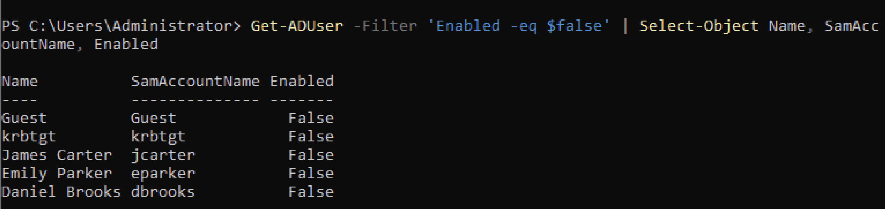

# Disabled Active Directory Accounts — IAM Audit Report

## 1. Audit Objective

Identify disabled user accounts in Active Directory using PowerShell as part of a simulated quarterly Identity and Access Management (IAM) audit.

The purpose of this exercise is to practice account discovery, identity lifecycle monitoring, and audit documentation.

## 2. Lab Environment

- **Operating System:** Windows Server 2022
- **Directory Service:** Active Directory Domain Services (AD DS)
- **Domain:** corp.iamlab.test
- **Tool:** Windows PowerShell
- **Environment:** Controlled Active Directory training lab

## 3. PowerShell Command

The following command was used to retrieve disabled Active Directory user accounts:

```powershell
Get-ADUser -Filter 'Enabled -eq $false' |
    Select-Object Name, SamAccountName, Enabled
```

### Command Explanation

- `Get-ADUser` retrieves user objects from Active Directory.
- `-Filter 'Enabled -eq $false'` limits the results to disabled accounts.
- `|` sends the results to the next command.
- `Select-Object` displays the requested account attributes.

## 4. Audit Results

The query returned **five disabled accounts** in the lab environment.

These included:

- Three fictional employee accounts.
- The built-in Guest account.
- The built-in krbtgt account.

The results demonstrate how PowerShell can identify disabled accounts for further IAM review.

## 5. IAM Analysis

Disabled accounts should be reviewed to determine whether their status aligns with organizational access policies.

During a real-world IAM audit, an analyst may:

1. Compare account status against HR employee records.
2. Verify whether former employees have been properly deprovisioned.
3. Identify accounts requiring further investigation.
4. Document findings and escalate exceptions to authorized personnel.
5. Preserve evidence for audit and compliance purposes.

**Important:** A disabled account is not automatically a security finding. The analyst must evaluate the account's purpose, ownership, and expected status.

Built-in accounts such as Guest and krbtgt require separate consideration from ordinary employee accounts.

## 6. Screenshot Evidence

The following screenshot documents the PowerShell command and its results in the training environment.



## 7. Conclusion

This lab demonstrated the use of PowerShell to identify disabled Active Directory accounts and document the results of a simulated IAM audit.

**Skills demonstrated:** Active Directory account auditing, PowerShell filtering, identity lifecycle awareness, and security documentation.

**Lab status:** Completed.
