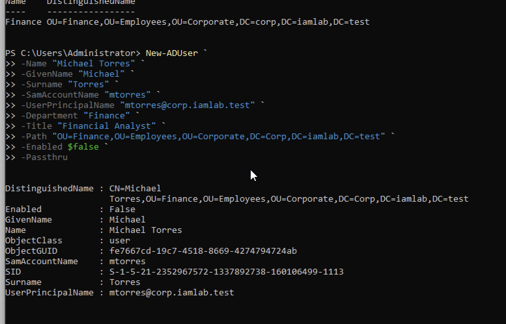
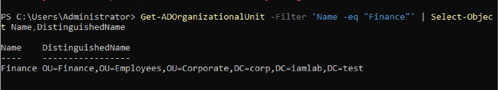
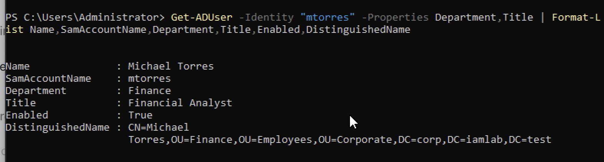
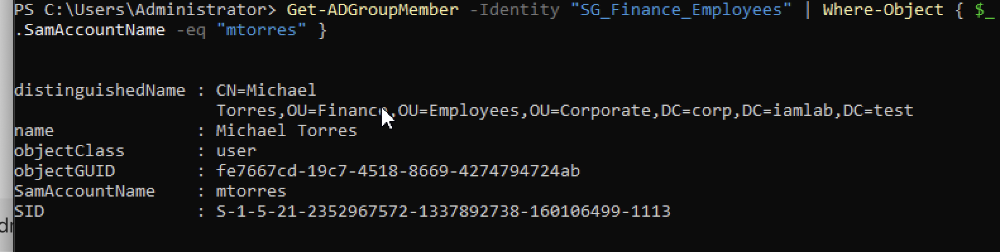
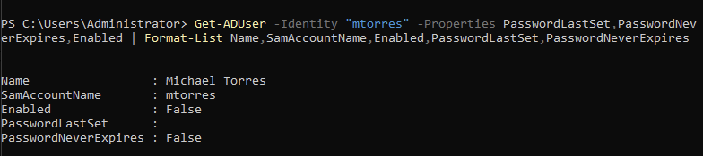
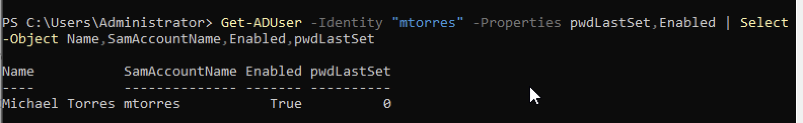
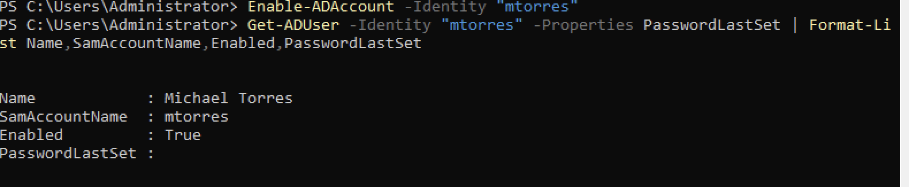

# Active Directory User Provisioning — IAM Audit Report

## 1. Project Overview

This project demonstrates a simulated employee onboarding workflow using Windows Server 2022, Active Directory Domain Services (AD DS), and PowerShell.

The objective was to provision a new employee account, assign approved security group membership, configure initial password security controls, and verify the account's final state.

**Ticket:** IAM-2026-002 (simulated)  
**Employee:** Michael Torres (fictional)  
**Department:** Finance  
**Job Title:** Financial Analyst  
**Username:** mtorres  
**Domain:** corp.iamlab.test

## 2. Lab Environment

- Windows Server 2022
- Active Directory Domain Services
- Windows PowerShell
- Domain: corp.iamlab.test
- Controlled training environment

## 3. Provisioning Workflow

### Step 1 — Verify Account Does Not Exist

Before provisioning, the username was checked to prevent duplicate account creation.

`Get-ADUser -Identity "mtorres"`

**Result:** Account not found.

### Step 2 — Identify the Correct Organizational Unit

The Finance OU was located using PowerShell.

`Get-ADOrganizationalUnit -Filter 'Name -eq "Finance"'`

**Verified OU:**

`OU=Finance,OU=Employees,OU=Corporate,DC=corp,DC=iamlab,DC=test`

### Step 3 — Create the Employee Account

A new Active Directory user was created with the appropriate name, username, department, title, and organizational unit.

The account was initially created in a disabled state.

**Command:** `New-ADUser`

**Result:** Michael Torres was successfully provisioned in the Finance OU.

### Step 4 — Verify Account Attributes

The new account was queried using `Get-ADUser`.

Verified attributes included:

- Name: Michael Torres
- Username: mtorres
- Department: Finance
- Title: Financial Analyst
- Account initially disabled
- Correct Finance OU placement

### Step 5 — Assign Approved Security Group

The simulated onboarding ticket authorized membership in `SG_Finance_Employees`.

`Add-ADGroupMember -Identity "SG_Finance_Employees" -Members "mtorres"`

Group membership was independently verified using `Get-ADGroupMember`.

### Step 6 — Configure Password Security

An initial password was entered using `Read-Host -AsSecureString` and applied with `Set-ADAccountPassword`.

The account was configured to require a password change at the next sign-in.

`Set-ADUser -Identity "mtorres" -ChangePasswordAtLogon $true`

Verification confirmed `pwdLastSet = 0`.

No plaintext passwords were included in the project documentation.

### Step 7 — Activate the Account

After completing the simulated provisioning checks, the account was enabled.

`Enable-ADAccount -Identity "mtorres"`

A final directory query confirmed:

- Enabled: True
- PasswordLastSet: Blank
- Password change required at next applicable sign-in

**Note:** Successful interactive authentication was not tested as part of this project.

## 4. Screenshot Evidence

### Account Creation

### Finance OU Verification

### Account Attribute Verification

### Finance Group Membership

### Pre-Activation Security Verification

### Password Change Requirement

### Account Activation

## 5. IAM Skills Demonstrated

- Employee onboarding and identity lifecycle management
- Active Directory account provisioning
- PowerShell administration
- Organizational Unit identification
- Role-based group assignment
- Access verification
- Initial credential configuration
- Audit evidence collection
- Technical troubleshooting

## 6. Conclusion

This simulated IAM onboarding exercise demonstrated the process of creating, configuring, and verifying an Active Directory employee account.

The project emphasizes the importance of validating identity information, assigning only approved access, configuring appropriate security controls, and documenting provisioning outcomes.

**Project status:** Completed technical provisioning lab.
