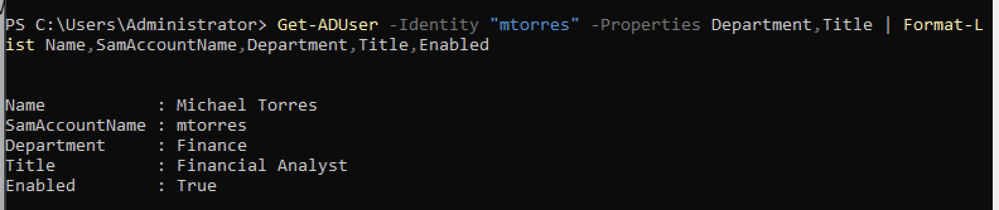
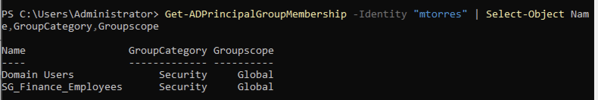
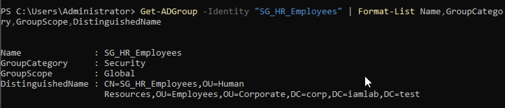
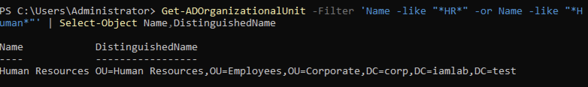
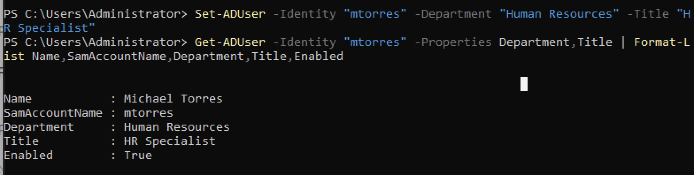
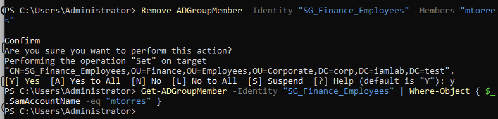
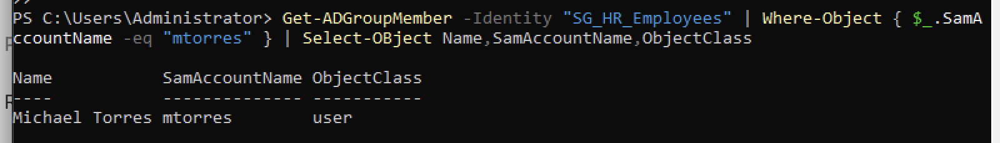
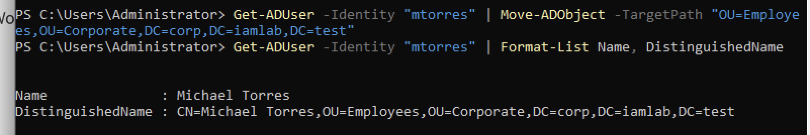
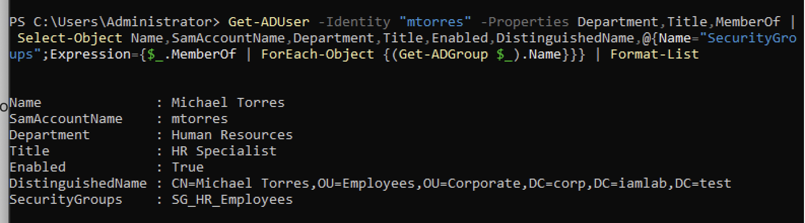

# Active Directory Employee Transfer — IAM Audit Report

## 1. Project Overview

This project simulates an employee department transfer using Windows Server 2022, Active Directory Domain Services (AD DS), and PowerShell.

The objective was to demonstrate the **Mover** stage of the Joiner–Mover–Leaver (JML) identity lifecycle, ensuring that an employee's directory information and assigned access reflect their new job responsibilities.

**IAM Ticket:** IAM-2026-003  
**Environment:** Simulated Active Directory lab  
**Employee:** Michael Torres (fictional)  
**Username:** mtorres  
**Domain:** corp.iamlab.test  
**Approval:** Simulated HR Manager approval

## 2. Employee Transfer Request

| Attribute | Before Transfer | After Transfer |
|---|---|---|
| Department | Finance | Human Resources |
| Job Title | Financial Analyst | HR Specialist |
| Security Group | SG_Finance_Employees | SG_HR_Employees |
| Organizational Unit | Finance OU | HR OU |
| Account Status | Enabled | Enabled |

## 3. IAM Transfer Workflow

### Step 1 — Verify Existing Account Attributes

Retrieved the employee's existing Active Directory attributes to establish a baseline before making changes.

### Step 2 — Review Existing Group Membership

Reviewed the employee's current security group memberships and confirmed membership in `SG_Finance_Employees`.

### Step 3 — Validate Destination Security Group

Verified that `SG_HR_Employees` existed and was configured as an Active Directory security group.

### Step 4 — Validate Destination Organizational Unit

Located the Human Resources Organizational Unit and confirmed its Distinguished Name before proceeding with the transfer.

### Step 5 — Update Employee Attributes

Updated the employee's department to Human Resources and job title to HR Specialist using PowerShell.

Verified that the account remained enabled.

### Step 6 — Remove Outdated Finance Access

Removed the employee from `SG_Finance_Employees` and verified that the employee was no longer a direct member.

This step demonstrates least-privilege access management and the removal of unnecessary permissions.

### Step 7 — Provision Approved HR Access

Added the employee to `SG_HR_Employees` and verified successful direct group membership.

### Step 8 — Transfer Account to HR OU

Moved the employee's Active Directory account from the Finance OU to the HR OU.

Verified the new location using the account's Distinguished Name.

### Step 9 — Perform Post-Transfer Access Verification

Conducted a final review confirming:

- Department updated to Human Resources
- Job title updated to HR Specialist
- Account remained enabled
- Account moved to the HR Organizational Unit
- Approved HR security group membership present
- Outdated direct Finance security group membership removed

## 4. IAM Controls Demonstrated

**Identity Lifecycle Management:** Updated an existing identity following an approved simulated employee role change.

**Least Privilege:** Removed outdated department access that was no longer required.

**Role-Based Access Control (RBAC):** Assigned the security group associated with the employee's new role.

**Access Provisioning and Deprovisioning:** Added approved HR group membership and removed obsolete Finance group membership.

**Audit Evidence:** Captured screenshots before, during, and after the transfer to document the technical workflow.

**Post-Change Validation:** Verified the employee's directory attributes, OU location, and direct group memberships.

## 5. Scope and Limitations

This project was completed in a simulated Active Directory environment using fictional employee information.

Verification focused on Active Directory attributes and direct group membership. Application-level permissions, nested group access, effective permissions, and authentication behavior were not independently tested.

## 6. Final Audit Finding

**Result: PASS — Simulated IAM employee transfer completed.**

The employee's Active Directory attributes, OU placement, and direct security group memberships were verified against the simulated transfer request.

The documented workflow demonstrates practical IAM operations associated with the Mover stage of the identity lifecycle.

## 7. Skills Demonstrated

- Identity and Access Management (IAM)
- Joiner–Mover–Leaver (JML) lifecycle
- Active Directory administration
- PowerShell
- User access reviews
- Access provisioning and deprovisioning
- Security group management
- Organizational Unit management
- Least privilege
- Role-Based Access Control (RBAC)
- Audit documentation and verification
