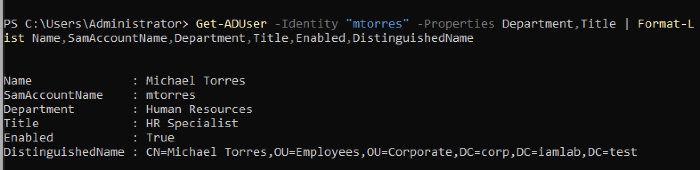
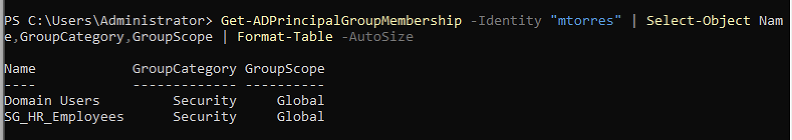
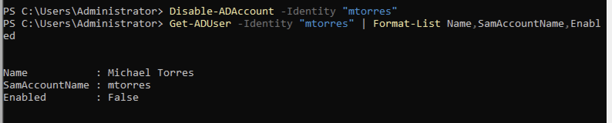
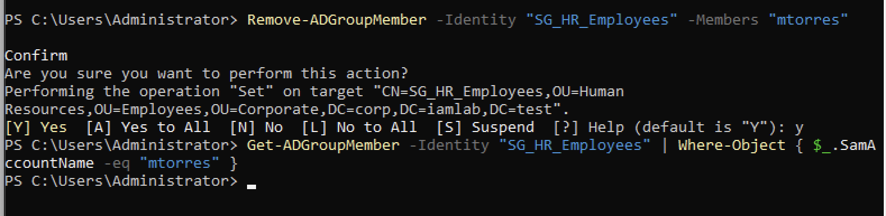
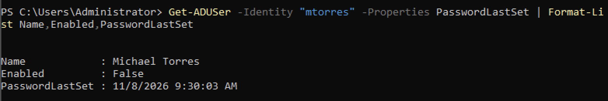
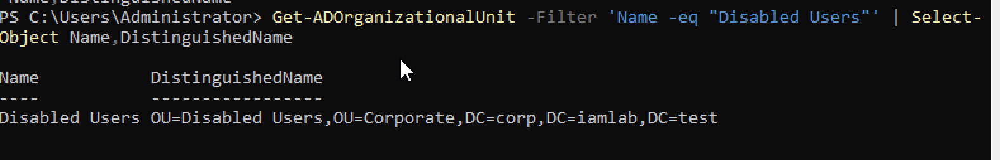
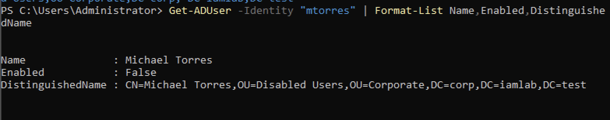
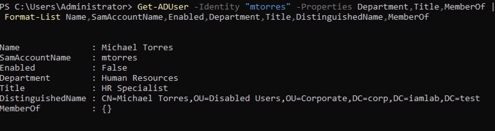

# Active Directory Employee Offboarding — IAM Audit Report

**Ticket ID:** IAM-2026-004  
**Project:** Active Directory Employee Offboarding (Leaver)  
**Environment:** Windows Server 2022 / Active Directory Domain Services  
**Domain:** corp.iamlab.test  
**Status:** Completed — Simulated Lab

---

## 1. Offboarding Request

An approved employee termination request was simulated for the following fictional employee:

| Field | Value |
|---|---|
| Employee | Michael Torres |
| Username | mtorres |
| Department | Human Resources |
| Job Title | HR Specialist |
| Request Type | Employee Termination / Access Deprovisioning |
| Authorization | Simulated HR Approval |
| Ticket | IAM-2026-004 |

**Objective:** Disable the employee's Active Directory account, remove direct HR security group access, reset credentials, and move the account to a designated Disabled Users Organizational Unit.

## 2. Pre-Offboarding Verification

Before making changes, the employee's identity and existing access were reviewed.

**Initial account state:**
- Account enabled: True
- Department: Human Resources
- Job title: HR Specialist
- Direct HR group membership: SG_HR_Employees

**Evidence:**

## 3. Account Deactivation

The employee's Active Directory account was disabled using PowerShell.

**Command:**

`Disable-ADAccount -Identity "mtorres"`

**Verification:** The account's Enabled property returned False.

**Evidence:**

## 4. Access Deprovisioning

The employee was removed from the HR security group.

**Command:**

`Remove-ADGroupMember -Identity "SG_HR_Employees" -Members "mtorres"`

**Verification:** A direct membership query confirmed that the employee was no longer a member of SG_HR_Employees.

**Evidence:**

## 5. Credential Reset

The employee's Active Directory password was reset to a randomly generated value.

**Verification:**
- PasswordLastSet updated.
- Account remained disabled.

**Security note:** Resetting an AD password does not guarantee immediate termination of all existing Kerberos service tickets, cloud sessions, or application sessions.

**Evidence:**

## 6. Disabled Users OU Creation

A dedicated Organizational Unit was created to organize disabled employee accounts.

**OU Distinguished Name:**

`OU=Disabled Users,OU=Corporate,DC=corp,DC=iamlab,DC=test`

**Evidence:**

## 7. Account Relocation

The disabled employee account was moved from the Human Resources OU into the designated Disabled Users OU.

**Final account location:**

`CN=Michael Torres,OU=Disabled Users,OU=Corporate,DC=corp,DC=iamlab,DC=test`

**Evidence:**

## 8. Final Offboarding Verification

A final Active Directory review confirmed the requested changes.

| Security Control | Verified Result |
|---|---|
| Account disabled | Passed — Enabled: False |
| Direct HR group access removed | Passed — SG_HR_Employees absent |
| Password reset | Passed — PasswordLastSet updated |
| Account moved to Disabled Users OU | Passed |
| Account retained for auditing | Passed — Account not deleted |

**Evidence:**

## 9. Security and Compliance Considerations

This simulated workflow demonstrates several IAM security practices:

- Employee lifecycle management (JML — Leaver)
- Account deactivation
- Direct group access removal
- Credential management
- Organizational Unit administration
- Audit evidence collection
- Post-change access verification

**Scope limitations:** This lab verifies on-premises Active Directory account status, OU placement, and direct HR group membership removal. It does not demonstrate revocation of cloud sessions, application-specific accounts, all nested or effective permissions, or organization-wide deprovisioning.

A production offboarding process would also require confirmation of applicable account retention policies, application access removal, and any additional termination controls.

## 10. Final Audit Conclusion

The simulated Active Directory offboarding request IAM-2026-004 was completed successfully.

Michael Torres's account was disabled, direct HR security group membership was removed, the account password was reset, and the account was relocated to the Disabled Users OU.

Final verification confirmed the account remained disabled and was no longer directly assigned to SG_HR_Employees.

**Audit outcome:** Passed for the defined Active Directory lab controls.

---

*This project was performed in a simulated IAM training environment using fictional employee information. It does not represent production employment activity.*
