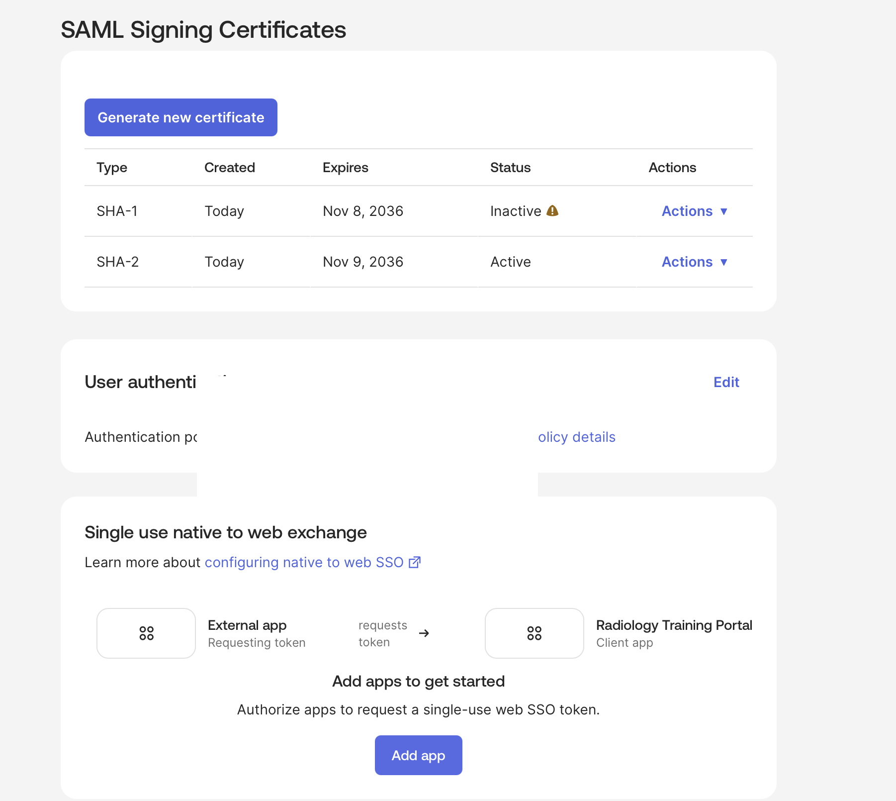
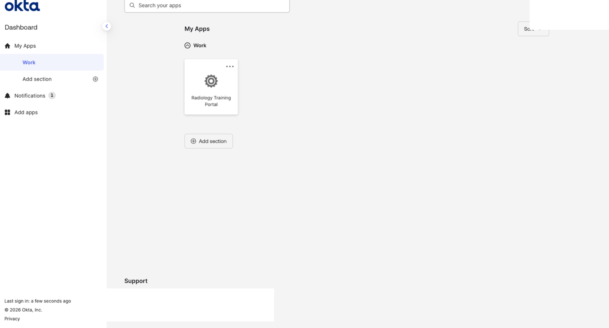
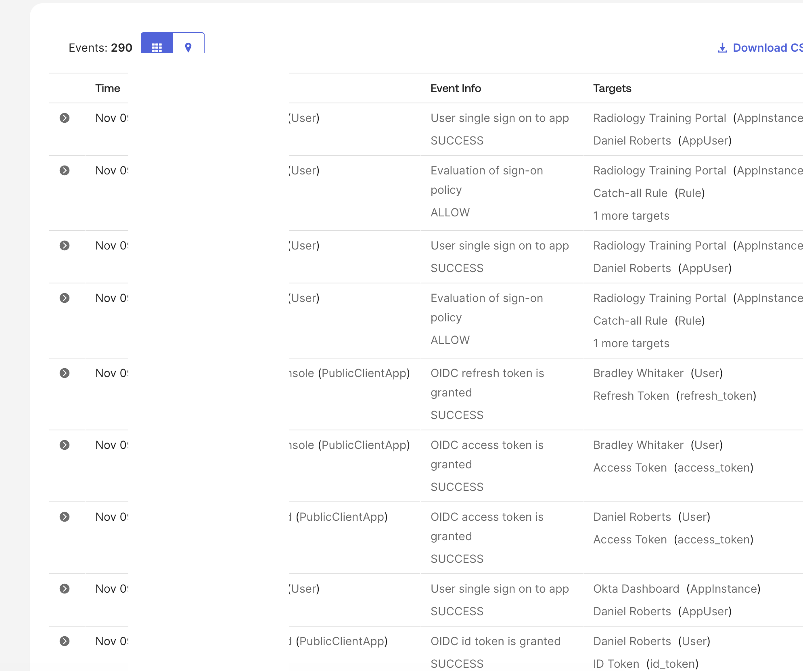
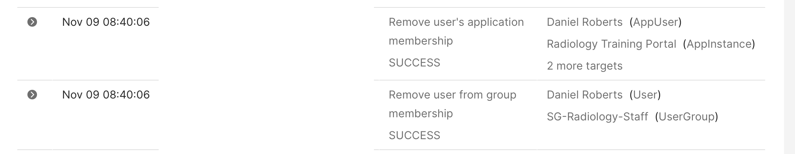
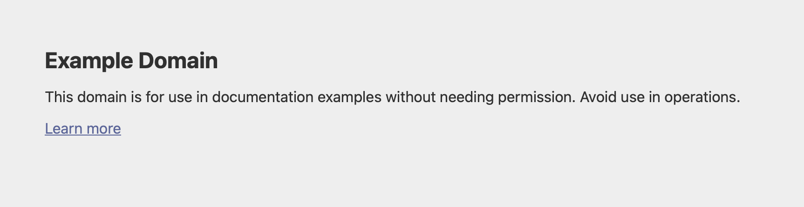

# Okta IAM Lab — Group-Based Application Provisioning & Access Revocation

## Project Overview

This hands-on Identity and Access Management (IAM) lab demonstrates the lifecycle of application access using Okta Workforce Identity.

I configured a simulated Radiology Training Portal application, provisioned access through security group membership, verified access from the end-user perspective, and revoked the application assignment by removing the user from the group.

The project focuses on group-based access control, identity lifecycle operations, SAML application configuration, and audit evidence.

**Environment:** Okta Integrator Free Plan (training environment)  
**Scenario:** Simulated healthcare organization — Radiology Department  
**Test User:** Daniel Roberts (fictional identity)  
**Security Group:** SG-Radiology-Staff  
**Application:** Radiology Training Portal (simulated SAML application)  
**Completion Date:** November 9, 2026

## Project Objectives

- Create and manage an Okta security group.
- Configure a custom SAML 2.0 application integration.
- Assign application access through group membership.
- Verify that a user inherits the application assignment.
- Activate a test user and verify the end-user dashboard.
- Inspect Okta System Log events for successful SSO processing.
- Revoke application access by removing group membership.
- Validate the resulting application unassignment using audit logs.

## Technologies & Concepts

- Okta Workforce Identity
- Okta Universal Directory
- Okta Groups
- SAML 2.0 configuration
- Single Sign-On (SSO)
- Group-based access control
- User provisioning and deprovisioning of application assignments
- Identity lifecycle management
- Okta System Log
- Audit trails and access verification
- Principle of least privilege

## Lab Scenario

Daniel Roberts is a fictional employee requiring access to a Radiology Training Portal.

Instead of assigning the application directly to Daniel, I used the SG-Radiology-Staff group to manage his access.

This approach allows application assignments to be managed centrally through group membership.

When Daniel no longer requires access, removing him from the group should remove his inherited application assignment.

## Implementation

### 1. Security Group Configuration

Created the security group:

`SG-Radiology-Staff`

Purpose: Represent standard Radiology department application access within the training environment.

Added Daniel Roberts as a group member.

### 2. SAML Application Configuration

Created a custom SAML 2.0 application integration named:

`Radiology Training Portal`

Configured the application in Okta and reviewed its SAML settings, metadata, and signing certificate configuration.

The integration used a simulated application endpoint for training purposes rather than a functional third-party Radiology system.

### 3. Group-Based Application Assignment

Assigned Radiology Training Portal to:

`SG-Radiology-Staff`

Verified that Daniel Roberts inherited the application assignment through his group membership.

This demonstrated the relationship between security group membership and application entitlement assignment.

### 4. User Activation and Access Verification

Completed Daniel's Okta account activation and password enrollment.

Confirmed:

- Daniel's Okta account status was Active.
- Radiology Training Portal appeared under Daniel's Assigned Applications.
- The application tile appeared on Daniel's Okta end-user dashboard.
- Okta System Log recorded successful SSO events associated with the application.

**Validation boundary:** The simulated application destination displayed an example domain page. Okta reported successful SSO processing, but end-to-end SAML authentication to a functioning service provider was not established.

### 5. Application Access Revocation

Removed Daniel Roberts from:

`SG-Radiology-Staff`

After removing the group membership, verified that Radiology Training Portal no longer appeared under Daniel's Assigned Applications.

This demonstrated the removal of an inherited Okta application assignment.

### 6. System Log Audit Verification

Reviewed Okta System Log entries dated November 9, 2026, at 08:40:06.

Two relevant events showed SUCCESS:

1. Remove user from group membership — Daniel Roberts / SG-Radiology-Staff
2. Remove user's application membership — Daniel Roberts / Radiology Training Portal

These events provide audit evidence connecting the group membership change with the removal of the application assignment.

## Verification Results

| Control Tested | Result |
|---|---|
| Security group created | Verified |
| User added to security group | Verified |
| SAML application integration created | Verified |
| Application assigned through group | Verified |
| Inherited application assignment | Verified |
| User account activated | Verified |
| Application visible on user dashboard | Verified |
| Okta SSO event recorded | Verified |
| User removed from security group | Verified |
| Application assignment removed | Verified |
| Revocation events recorded in System Log | Verified |
| End-to-end third-party SAML login | Not tested successfully |

## Security & IAM Takeaways

**Centralized access management:** Group-based assignments simplify entitlement administration by allowing access to be granted or removed through membership changes.

**Least privilege:** Removing a user from an access group can remove application entitlements that are no longer required.

**Auditability:** Okta System Log provides evidence of identity administration actions and resulting application membership changes.

**Verification matters:** An IAM administrator should confirm the actual entitlement state and review relevant logs rather than assume that a group change completed successfully.

## Scope & Limitations

This project was completed in a personal Okta training environment using fictional identities and a simulated application.

It demonstrates Okta-side application assignment, activation, group membership management, SSO event inspection, and application unassignment.

It does not demonstrate SCIM provisioning, deletion of accounts in an external application, production authorization controls, or completed SAML authentication to a functioning third-party service provider.

## Evidence

Screenshots documenting configuration, assignment, user access, and revocation will be added to the project evidence folder.

### 1. SAML Application Configuration
Configured a simulated Radiology Training Portal application using Okta's SAML 2.0 integration.

### 2. End-User Application Assignment
Verified that the Radiology Training Portal appeared on Daniel Roberts' Okta dashboard through group-based assignment.

### 3. Okta SSO Audit Evidence
Reviewed the Okta System Log and confirmed a successful Okta-side SSO event. The simulated service provider did not complete end-to-end SAML authentication.

### 4. Access Revocation Audit Evidence
Removed Daniel Roberts from SG-Radiology-Staff and confirmed successful group membership removal and application unassignment events.

### 5. Simulated Application Limitation
Documented the example-domain destination used for this training lab, distinguishing Okta-side SSO events from actual service-provider authentication.

### Evidence Index
[View the full evidence index](EVIDENCE_INDEX.md)
  

## Skills Demonstrated

Okta Administration | Identity & Access Management | Group-Based Access Control | Application Provisioning | Access Revocation | SAML Configuration | SSO Troubleshooting | Audit Log Analysis | Identity Lifecycle Management
  
